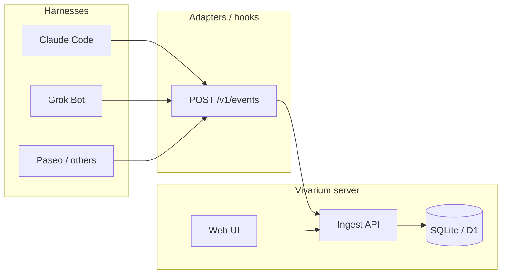

# Architecture

Vivarium (活体台) is a **self-hosted**, harness-agnostic platform for Agent **lifecycle visibility** and **chat observability**. It does not replace your harness; hooks and adapters report structured events to a central server. The web UI renders cute Agent cards, step progress, logs, and transcript replay. **Handoff** packages context so the same conversation can continue on another harness.

## High-level flow

## Components

| Layer | Role |
|-------|------|
| **Schema** (`@vivarium/schema`) | Canonical event + transcript + handoff types (Zod). |
| **SDK** (`@vivarium/sdk`) | Small client: authenticate, batch POST events. |
| **API** (`@vivarium/api`) | Ingest + query API; **M1:** SQLite persistence (`sessions`, `events`). |
| **Web** (`@vivarium/web`) | React console: session cards, steps timeline, transcript replay (M3 polling UI). Theme via CSS variables (`src/theme/skin.ts`, aligned with example-skin). |
| **Plugins** | Manifest + slots (theme, emoji, avatar, future adapters). Unload rolls back side effects. |
| **Adapters** | Claude Code hooks (M2); more harnesses later. |

Storage details: [storage.md](./storage.md).

## Session model

- One **session** = one Agent run tied to `agent_id` (stable for the card) and `session_id` (this run).
- Events are **append-only** in SQLite (`events` table); session metadata is denormalized in `sessions`.
- **Transcript** is derived from `session.turn` events ordered by event `id` (and `session.step` merged by `step_id` for current step view).

## Privacy

- Never send API keys, OAuth tokens, or `.env` contents.
- Prefer **workspace-relative** paths; if you must send `cwd`, document redaction in the adapter (e.g. replace `$HOME` with `~`).
- Handoff payloads reference a **transcript_ref** on the server rather than duplicating secrets.

## Plugin host (sketch)

Inspired by DeepSeek Harness “everything is a plugin”:

1. Load `manifest.json` (id, version, `provides`, `slots`).
2. Register contributions into named slots (e.g. `theme.default`, `emoji.semantic.*`).
3. On unload, run plugin `cleanup` and revert slot overrides.

See [plugins.md](./plugins.md).

## Deployment notes

- **Local dev**: SQLite file (`VIVARIUM_DB_PATH`, default `./data/vivarium.db`).
- **Single binary / Docker**: API + static web assets; mount a volume for `data/`.
- **Edge (future)**: D1 for the same tables; R2 for large transcript blobs; Workers for API.

See [roadmap.md](./roadmap.md) for milestone status.
