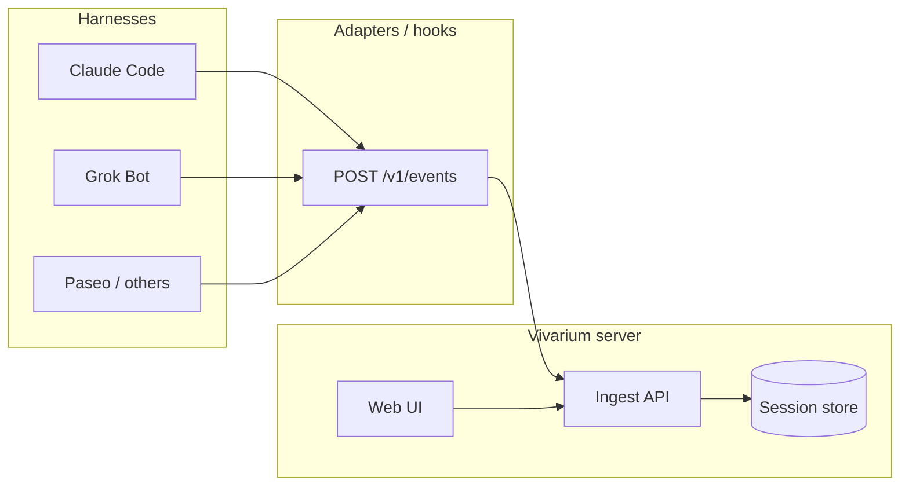

# Architecture

Vivarium (活体台) is a **self-hosted**, harness-agnostic platform for Agent **lifecycle visibility** and **chat observability**. It does not replace your harness; hooks and adapters report structured events to a central server. The web UI renders cute Agent cards, step progress, logs, and transcript replay. **Handoff** packages context so the same conversation can continue on another harness.

## High-level flow

## Components (M0)

| Layer | Role |
|-------|------|
| **Schema** (`@vivarium/schema`) | Canonical event + transcript + handoff types (Zod). |
| **SDK** (`@vivarium/sdk`) | Small client: authenticate, batch POST events. |
| **API** (`@vivarium/api`) | Stub ingest + health; M1+ persists to SQLite or Cloudflare D1. |
| **Web** (`@vivarium/web`) | Vite + React shell; M1+ live cards and replay. |
| **Plugins** | Manifest + slots (theme, emoji, avatar, future adapters). Unload rolls back side effects. |
| **Adapters** | Harness-specific hooks that map local session data to schema events. |

## Session model

- One **session** = one Agent run tied to `agent_id` (stable for the card) and `session_id` (this run).
- Events are append-only on the server (M0 accepts and logs; persistence TBD).
- **Transcript** is derived from `session.turn` events (and tool metadata when present).

## Privacy

- Never send API keys, OAuth tokens, or `.env` contents.
- Prefer **workspace-relative** paths; if you must send `cwd`, document redaction in the adapter (e.g. replace `$HOME` with `~`).
- Handoff payloads reference a **transcript_ref** on the server rather than duplicating secrets.

## Plugin host (sketch)

Inspired by DeepSeek Harness “everything is a plugin”:

1. Load `manifest.json` (id, version, `provides`, `slots`).
2. Register contributions into named slots (e.g. `theme.default`, `emoji.semantic.*`).
3. On unload, run plugin `cleanup` and revert slot overrides.

See [plugins.md](./plugins.md).

## Deployment notes (future)

- **Single binary / Docker**: API + static web assets.
- **Edge**: D1 for events, R2 for large transcript blobs, Workers for API.
- **Local dev**: SQLite file next to API process.

M0 does not implement persistence; see [roadmap.md](./roadmap.md).
