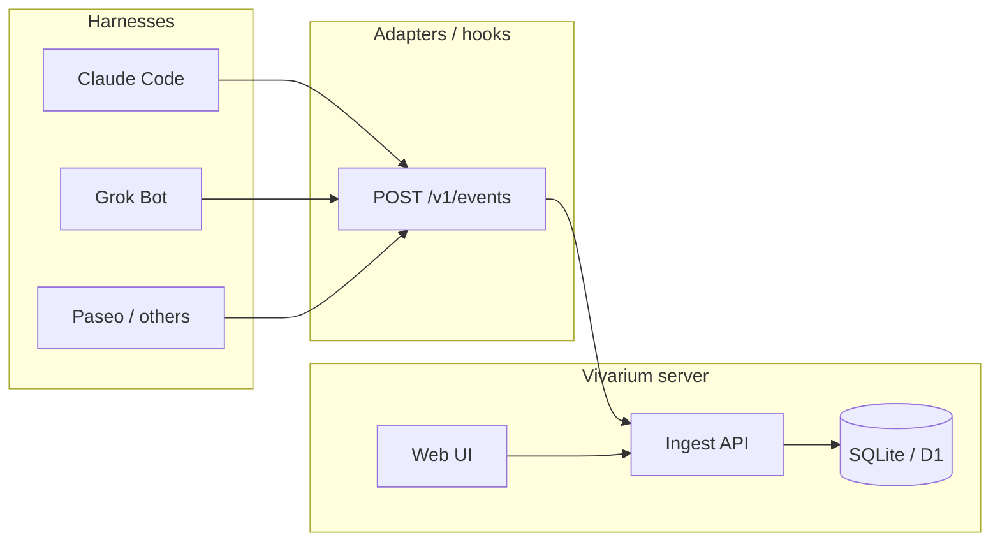

# Architecture

Vivarium (活体台) is a **self-hosted**, harness-agnostic platform for Agent **lifecycle visibility** and **chat observability**. It does not replace your harness; hooks and adapters report structured events to a central server. The web UI renders cute Agent cards, step progress, logs, and transcript replay. **Handoff** packages context so the same conversation can continue on another harness.

## High-level flow

## Components

| Layer | Role |
|-------|------|
| **Schema** (`@vivarium/schema`) | Canonical event + transcript + handoff types (Zod). |
| **SDK** (`@vivarium/sdk`) | Small client: authenticate, batch POST events. |
| **API** (`@vivarium/api`) | Ingest + query. **M7:** `agents` table, light router on `session.start`, `POST /v1/brain/suggest`. |
| **Web** (`@vivarium/web`) | React console. Home is product-line cards; a line drills into sessions, steps, and transcript. |
| **Plugins** | Manifest + slots (theme, emoji, avatar, future adapters). Unload rolls back side effects. |
| **Adapters** | Claude Code hooks (M2); more harnesses later. |

Storage details: [storage.md](./storage.md).

## Product model

- **Agent** = a lasting product line (天眼 `tianyan`, 公司 `company`, 待分拣 `inbox`, …). Not a chat, and not a harness.
- **Session** = one harness run. It always hangs under a real `agent_id`. The same line can have many sessions on many harnesses.
- The id an adapter sends on `session.start` is a **hint** (`reported_agent_id`). Values like `claude-code:dry-run` are not product lines.
- A **light router** classifies that hint plus cwd / `#tags` / task keywords once at ingest. Low confidence goes to `inbox`.
- The **brain** reads a line later: progress in plain language, and suggestions (`reassign` | `nudge` | `summary` | `handoff`). It does not call the harness.

See [routing.md](./routing.md).

## Session model

- Events are **append-only** in SQLite (`events` table). The stored payload keeps the adapter’s original `agent_id`.
- Session metadata is denormalized in `sessions`, including the routed product-line id.
- **Transcript** is derived from `session.turn` events ordered by event `id` (and `session.step` merged by `step_id` for current step view).
- The web home lists **product lines**. A line opens onto its sessions. Flat “all sessions” is a secondary filter.

## Privacy

- Never send API keys, OAuth tokens, or `.env` contents.
- Prefer **workspace-relative** paths; if you must send `cwd`, document redaction in the adapter (e.g. replace `$HOME` with `~`).
- Handoff payloads reference a **transcript_ref** on the server rather than duplicating secrets.

## Plugin host (sketch)

Inspired by DeepSeek Harness “everything is a plugin”:

1. Load `manifest.json` (id, version, `provides`, `slots`).
2. Register contributions into named slots (e.g. `theme.default`, `emoji.semantic.*`).
3. On unload, run plugin `cleanup` and revert slot overrides.

See [plugins.md](./plugins.md).

## Deployment notes

- **Local dev**: SQLite file (`VIVARIUM_DB_PATH`, default `./data/vivarium.db`).
- **Single binary / Docker**: API + static web assets; mount a volume for `data/`.
- **Edge (future)**: D1 for the same tables; R2 for large transcript blobs; Workers for API.

See [roadmap.md](./roadmap.md) for milestone status.
